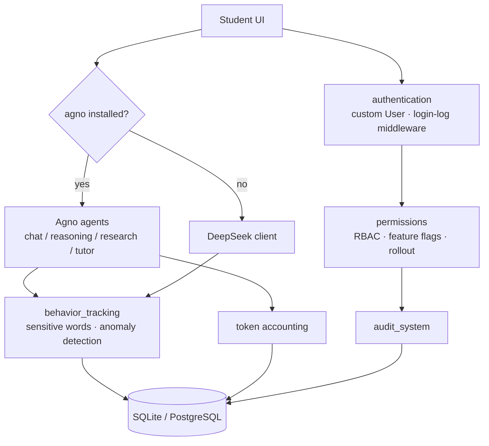

# AI Agent Platform · Multi-Agent Platform for Universities

**English** | [简体中文](README.md)


> A governance layer for "letting students use LLM assistants", built on Django.
> Students get multi-agent chat (Agno + DeepSeek dual engine); administrators get RBAC feature
> flags with staged rollout, sensitive-content and anomaly monitoring, session auditing, and
> per-user token accounting.
>
> **The problem it solves**: turning "should we open up an LLM to students?" into a backend that
> can be switched on per class, traced per message, and costed per user.

## Why this is more than a chat page

Opening an LLM to students fails on four things, not on wiring an API:

| Risk | Without it | Module in this repo |
| --- | --- | --- |
| **Permissions** | one entry point for everyone; the monthly budget burns in a night | `permissions`: feature-level ACL, student groups, rollout allow-list |
| **Traceability** | when something goes wrong, nobody knows who asked what | `behavior_tracking` + `audit_system`: sessions persisted, actions audited |
| **Compliance** | sensitive topics pass through silently | ~60 words in 5 categories + leetspeak/variant regex + intent regex, hard block on high risk |
| **Cost** | only a total bill, no idea who spends it | token accounting aggregated per user / feature / day, exportable |

## Architecture



Engine downgrade happens at runtime: if `import agno` fails the platform falls back to the native
DeepSeek client, so the core chat path works in an environment without Agno installed.

## Capabilities

| Capability | Where |
| --- | --- |
| Four specialised agents, cached per session | `ai_agent/agno_django_service.py` |
| Dual engine + graceful degradation | `ai_agent/services.py` |
| Session persistence (dual-write messages, server-side counters) | `behavior_tracking/models.py` |
| Three-layer RBAC (role → feature permission → DRF view) | `authentication/decorators.py`, `permissions/decorators.py` |
| Feature toggles with 6-level fallback + quota | `permissions/function_toggle_service.py` |
| Staged rollout, deterministic per user via `random.seed(user.id)` | `permissions/models.py` |
| Sensitive-content monitor, anomaly detector | `behavior_tracking/services.py` |
| Audit trail with password/token/secret masking | `authentication/middleware.py`, `audit_system/services.py` |
| Token + cost accounting, daily aggregation | `ai_agent/models.py`, `management/commands/update_token_usage.py` |

Scale: 6 Django apps, 26 models, ~113 Python files / 17k lines, 36 templates / 12k lines.

## Notable debugging stories

Full write-ups live in [`docs/devlog/`](docs/devlog/):

1. **Every reply was fake** — DeepSeek `base_url` was missing `/v1` and the view had been replaced
   with a mock, so no request was ever sent.
2. **Page loaded, chat returned 403** — the CSRF token script came from an unreachable CDN.
   Fixed with a working CDN plus a `meta[name=csrf-token]` fallback.
3. **Agno history vanished on refresh** — messages only lived in front-end memory.
4. **Agno reported 0 tokens** — the SDK returns no usage; unified to a `len(text)//4` estimate and
   back-filled 1478 historical messages.
5. **Three conflicting token definitions** — standardised on "all messages count, user→input,
   assistant→output".
6. **Monitoring dashboard was fake data** — rewritten with a real lexicon and variant/intent regex;
   this is also what exposed the duplicated `AIFunction` definition.

## Quick start

```bash
git clone https://github.com/DOUFUQAQ/ai-agent-platform.git
cd ai-agent-platform
python -m venv .venv && source .venv/bin/activate
pip install -r requirements.txt

cp .env.example .env          # at minimum set DEEPSEEK_API_KEY
python manage.py migrate
python manage.py createsuperuser
python manage.py runserver
```

Or with Docker:

```bash
cp .env.example .env
docker compose up --build
```

Without any API key the platform still boots and the chat endpoint returns a clear error instead of
crashing — a deliberate choice for demos and acceptance testing.

## Known issues

- `AIFunction` is defined twice (different field names) — two call sites already raise `FieldError`.
- `ai_agent/reports.py` (~550 lines) is currently unreferenced; PDF export is unfinished.
- No streaming: the `stream` flag exists but nothing enables it.
- Daily token aggregation is produced by an offline command only.
- Test coverage is still thin: this round adds 23 contract tests (custom user model, permission
  model fields, session/token models, no-secret-leak guard); views are not covered yet.
- CDN localisation is only half done (8 templates still reference jsdelivr).

## Roadmap

- [ ] Collapse the duplicated `AIFunction` model
- [ ] SSE streaming for chat
- [ ] Real-time token accounting
- [ ] Unit + integration tests, green CI
- [ ] Vendor all front-end CDN assets for offline use
- [ ] PostgreSQL + Redis deployment profile

## License

[MIT](LICENSE) © 2025 DOUFUQAQ
