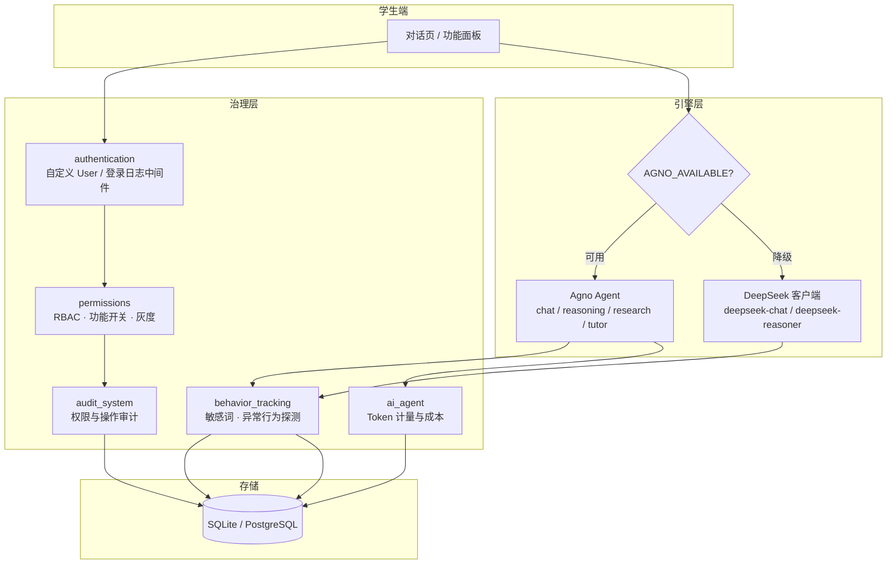

# AI Agent Platform · 高校多智能体教学平台

[English](README.en.md) | **简体中文**


> 给学校用的"学生用 AI 助手"治理平台。
> 学生端是多智能体对话（Agno / DeepSeek 双引擎），管理端是 RBAC 功能开关 + 灰度发布 +
> 敏感词与异常行为监控 + 会话审计 + Token 计量。
>
> **一句话概括它解决的问题**：把"能不能给学生开放大模型"从一句口号，变成一套可开关、可追溯、可计量的后台。

---

## 为什么不是一个聊天页面

高校真要把 LLM 开放给学生，卡点从来不在"接个 API"，而在这四件事：

| 卡点 | 如果没有它会怎样 | 本项目的对应模块 |
| --- | --- | --- |
| **权限** | 所有学生拿到同一个万能入口，付费额度被某个班一晚上跑光 | `permissions`：功能级权限 + 学生分组 + 灰度白名单 |
| **可追溯** | 出了舆情事件，查不到谁在什么时候问了什么 | `behavior_tracking` + `audit_system`：会话入库、操作审计、登录日志 |
| **合规** | 敏感话题无人拦截 | 敏感词监控：5 类约 60 词 + 变体正则 + 意图正则，高风险直接拦截 |
| **成本** | 只知道"总账单"，不知道谁在烧 | Token 计量：按用户/按功能/按天聚合，可导出 Excel |

所以这是一个**带治理能力的多智能体平台**，而不是一个套了皮肤的 ChatGPT 前端。

---

## 架构



引擎层的降级是**运行时判断**：`try: import agno` 失败时自动走 DeepSeek 原生客户端，
因此在一个没装 Agno 的环境里，平台的核心对话链路依然可用。

---

## 核心能力与实现位置

| 能力 | 关键实现 | 说明 |
| --- | --- | --- |
| 多智能体对话 | `ai_agent/agno_django_service.py` | 四种 Agent（通用问答 / 推理 / 检索 / 助教），按需构造并缓存 |
| 双引擎与降级 | `ai_agent/services.py` | DeepSeek 原生客户端 + Agno，二者统一返回同一结构 |
| 会话持久化 | `behavior_tracking/models.py::ChatSession/ChatMessage` | 每轮双写消息与服务端会话计数，刷新后可回放历史 |
| 三层 RBAC | `authentication/decorators.py`、`permissions/decorators.py` | 角色 → 功能权限 → DRF 视图级权限 |
| 功能开关 | `permissions/function_toggle_service.py` | 学生级 / 分组级 / 全局级逐级回退，带缓存与频率配额 |
| 灰度发布 | `permissions/models.py::GrayReleaseConfig` | 白名单 + 分组；用 `random.seed(user.id)` 保证同一用户命中结果稳定 |
| 敏感内容监控 | `behavior_tracking/services.py::SensitiveWordMonitor` | 分类词库 + 变体正则（同音/拆字）+ 意图正则，高风险直接拦截 |
| 异常行为探测 | `behavior_tracking/services.py::AbnormalBehaviorDetector` | 阈值规则 + risk_score 累计 |
| 审计 | `authentication/middleware.py`、`audit_system/services.py` | 登录日志、权限变更审计，落库前对 password / token / secret 脱敏 |
| Token 计量 | `ai_agent/models.py::APIUsageLog`、`management/commands/update_token_usage.py` | 记录 prompt / completion / total 与成本，按天聚合到 `UserTokenUsage` |
| 报表导出 | `student_management/views.py`、`ai_agent/reports.py` | Excel 导出已可用；PDF 部分仍是半成品（见"已知问题"） |

数据规模：6 个 app、26 个 Model、约 113 个 Python 文件 / 17k 行，模板 36 个 / 12k 行。

---

## 几个真实踩过的坑

这些问题都留下了排查记录，收在 [`docs/devlog/`](docs/devlog/)，因为它们比成功路径更有信息量：

1. **DeepSeek 全部返回假回复** —— `base_url` 少了 `/v1`，且视图层被替换成 mock，请求根本没发出去。
   修复：补全路径、恢复真实调用，mock 只保留为显式降级分支。→ [`docs/devlog/deepseek-integration.md`](docs/devlog/deepseek-integration.md)
2. **页面能开、聊天 403** —— CDN 不可达导致 `csrf` token 脚本没加载，POST 全部被拦。
   修复：换可用 CDN + `meta[name=csrf-token]` 与 cookie 双通道注入。→ [`docs/devlog/csrf-behind-cdn.md`](docs/devlog/csrf-behind-cdn.md)
3. **Agno 对话刷新即丢** —— 消息只存在前端内存里。
   修复：后端双写 `ChatMessage`，前端携带 `session_id` 回读历史。→ [`docs/devlog/agno-session-persistence.md`](docs/devlog/agno-session-persistence.md)
4. **Agno 的 Token 恒为 0** —— SDK 不回传 usage。
   修复：统一用 `len(text)//4` 估算，并回填了 1478 条历史消息的用量。→ [`docs/devlog/agno-token-accounting.md`](docs/devlog/agno-token-accounting.md)
5. **三处 Token 口径互相矛盾** —— 有的只算 assistant、有的 input 恒为 0。
   修复：统一为「全部消息参与统计，user→input，assistant→output」，三处脚本同步。→ [`docs/devlog/token-statistics.md`](docs/devlog/token-statistics.md)
6. **监控面板全是假数据** —— 早期为了演示写死了结果。
   修复：重写为真实词库 + 变体正则 + 意图正则，并暴露出 `AIFunction` 在两个 app 里重复定义的隐患。→ [`docs/devlog/sensitive-content.md`](docs/devlog/sensitive-content.md)

---

## 快速开始

```bash
git clone https://github.com/DOUFUQAQ/ai-agent-platform.git
cd ai-agent-platform

python -m venv .venv
# Windows: .venv\Scripts\activate
source .venv/bin/activate

pip install -r requirements.txt

cp .env.example .env
# 编辑 .env，至少填入 DEEPSEEK_API_KEY（或 OPENAI_API_KEY 指向兼容端点）

python manage.py migrate
python manage.py createsuperuser
python manage.py runserver
```

打开 <http://127.0.0.1:8000/> 进入首页，<http://127.0.0.1:8000/admin/> 进入后台。

**不配密钥会怎样？** 平台照常启动，对话接口返回明确的错误提示而不是崩溃——
这比"启动即挂"更适合演示和验收。

### 用 Docker 跑

```bash
cp .env.example .env      # 填好密钥
docker compose up --build
```

### 造一些演示数据

```bash
python scripts/seed_demo_data.py          # 用户 / 分组 / 会话
python scripts/seed_dashboard_data.py     # 看板用统计数据
python scripts/backfill_token_usage.py    # 回填 Token 日聚合
```

---

## 项目结构

```
ai-agent-platform/
├── ai_agent/                 # 对话引擎：Agno / DeepSeek 双实现、服务层、API
│   ├── services.py           # DeepSeek 客户端 + 统一服务入口
│   ├── agno_django_service.py# Agno 集成（会话双写、Token 估算）
│   ├── api_views.py / views.py
│   ├── models.py             # AIModel / APIUsageLog / UserTokenUsage
│   ├── reports.py            # Excel / PDF 报表（部分功能仍在开发）
│   └── management/commands/  # update_token_usage 等
├── authentication/           # 自定义 User、登录日志、脱敏中间件
├── permissions/              # RBAC、功能开关、灰度发布
├── behavior_tracking/        # 会话与消息、敏感词、异常行为、审计日志
├── audit_system/             # 权限审计视图与聚合
├── student_management/       # 学生档案、标签、用量统计
├── ai_agent_platform/        # settings / urls / wsgi
├── templates/                # 36 个页面（对话页单文件 ~2.3k 行）
├── scripts/                  # 造数脚本、QA 自动化（Playwright）
├── docs/devlog/              # 排查记录
├── Dockerfile · docker-compose.yml
└── .env.example
```

---

## 已知问题

写在这里不是自曝其短，而是这份清单本身就是工程判断的一部分——它说明我知道系统现在站在哪：

- **`AIFunction` 在两个 app 里重复定义**（`ai_agent` 用 `code`，`permissions` 用 `function_code`），
  已有两处调用必然抛 `FieldError`，其中一处被裸 `except` 吞掉了。这是下一步要拆的第一颗雷。
- **`ai_agent/reports.py`（约 550 行）目前零引用**，`behavior_tracking` 的导出接口仍返回"待实现"。
- **没有流式输出**：`stream` 参数存在但没有任何调用点开启，前端是假打字动画。
- **Token 日聚合只由离线命令生成**，实时链路还没有写入 `UserTokenUsage`。
- **测试覆盖仍然偏薄**：6 个 `tests.py` 长期是空文件，本轮补了 23 个契约测试
  （自定义 User 模型、权限模型字段、会话/计量模型、密钥不外泄），还没有覆盖视图层。
- **CDN 修复只完成一半**：`base.html` 已切到可用源，仍有 8 个模板引用 jsdelivr。

## Roadmap

- [ ] 拆分重复的 `AIFunction` 定义，收敛到单一模型
- [ ] 对话接口改为 `StreamingHttpResponse`（SSE），前端接真流式
- [ ] Token 计量接入实时链路，去掉离线回填依赖
- [ ] 补单元测试与集成测试，CI 全绿
- [ ] 把第三方 CDN 依赖全部本地化（离线可用）
- [ ] PostgreSQL + Redis 部署方案，替换 SQLite / LocMemCache

## License

[MIT](LICENSE) © 2025 DOUFUQAQ
